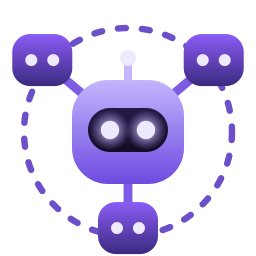

<p align="center"></p>

<h1 align="center">AgentFlow</h1>

<p align="center">Project management for a team of Claude agents and the person they work for.</p>

<p align="center"><a href="https://giosuel.github.io/agent-flow/">Website and docs</a> ·
<a href="https://giosuel.github.io/agent-flow/docs/getting-started/">Getting started</a> ·
<a href="https://giosuel.github.io/agent-flow/docs/reference/mcp/">MCP tools</a></p>

Each project has one agent. It records its milestones, steps, tasks, questions, decisions, pull
requests, releases, test builds and notes in AgentFlow over MCP, instead of in Markdown files in the
repository. The owner answers questions, presses Merge and Push tag, tries builds and sends
contributions from a web app that also works as a home-screen app on the phone. Everything that
happens is logged.

## Features

- **Questions become decisions.** Agents ask one question at a time, with numbered options and a
  recommendation. The answer is recorded as a decision in the owner's words and unblocks the tasks
  that waited.
- **The plan.** Milestones that end with a tag, steps that start and conclude as the work does,
  tasks with estimates, and time counted from the tasks' states.
- **Pull requests in merge order.** PRs are read from GitHub every three minutes. Each gets a Merge
  button; a stack merges from the bottom with one **Merge #a–#b**. A release's **Push tag** unlocks
  once its PRs are merged and closes the milestone.
- **Test builds.** Agents publish with `flow publish`; the owner runs them on any machine with
  `flow run` and marks what to try Works, Problem or Skip.
- **Contributions.** Agents draft PRs, issues and comments for other people's repositories; only the
  owner sends them, as themselves.
- **The log.** One row for every MCP call, API call, page view and button press, kept for good.
- **Usage and the machine.** Token use per agent, project and task at API prices, the plan's 5-hour
  and weekly windows, and the server's CPU and memory per agent.
- **Build servers.** Machines that connect themselves and run agents' builds with `flow remote`.

## Install

From v0.1.0, releases publish Linux x86_64 programs and `.deb` packages on
[GitHub Releases](https://github.com/giosuel/agent-flow/releases), and AUR packages. Until then,
build from source.

```sh
# Debian, Ubuntu (from v0.1.0): the server needs the client package too
sudo apt install ./agentflow-client_0.1.0_amd64.deb ./agentflow_0.1.0_amd64.deb

# Arch (from v0.1.0)
yay -S agentflow-bin    # the release programs
yay -S agentflow        # built from the tagged source

# From source (Rust 1.90 or newer)
git clone https://github.com/giosuel/agent-flow && cd agent-flow
cargo build --release --locked
sudo install -m 755 target/release/{agentflow,flow,agentflow-builder} /usr/local/bin/
```

There are three programs:

- `agentflow`: the server, a background program under systemd (the web app, the MCP endpoint, the
  API, setup);
- `flow`: the command people and agents type;
- `agentflow-builder`: a build machine's background program.

## Quick start

On the server, as root, once. Setup creates the user `agentflow`, writes
`/etc/agentflow/config.toml`, installs the system service (data in `/var/lib/agentflow`) and
`agentflow-hands`, a user service of the agents' user that does what has to happen as them:

```sh
sudo agentflow setup --public-url https://flow.example --agents-user <user> --dry-run  # the steps
sudo agentflow setup --public-url https://flow.example --agents-user <user>
# then, as the agents' user:
systemctl --user daemon-reload; systemctl --user enable --now agentflow-hands
```

Put https in front (passkeys and push need a domain name). With Caddy:

```
flow.example {
    reverse_proxy 127.0.0.1:8790
}
```

Add your passkey with the one-time link this prints (valid 15 minutes):

```sh
sudo flow server add-passkey
```

Then connect each machine and set up a project in its folder:

```sh
curl -fsSL https://flow.example/install.sh | sh    # or: flow connect https://flow.example
cd ~/my-project && flow project setup               # Enter at the prompt creates a new project
claude
```

On a personal machine, `scripts/install.sh` builds the programs and runs the server as a systemd
user service instead; everything then runs as you.

## How agents connect

AgentFlow serves MCP over streamable HTTP at `/mcp`. `flow project setup` writes the project's
`.mcp.json`, with the token read from its file by Claude Code's `headersHelper`, so it never sits in
a config:

```json
{
  "mcpServers": {
    "agentflow": {
      "type": "http",
      "url": "https://flow.example/mcp",
      "headersHelper": "flow mcp-headers --token-file ~/.config/agentflow/tokens/<project>.token"
    }
  }
}
```

It also writes `.claude/settings.local.json`: hooks that run `flow hello` at every session start,
`flow news` before each prompt and `flow sync` after each reply, the status line, and
`AGENTFLOW_TOKEN_FILE` for the agent's `flow` commands. Both files stay out of git through
`.git/info/exclude`. A project's token changes only its own project and reads all others; merges and
tags are pressed only from the owner's signed-in browser.

## Architecture

- One Rust crate, three programs. The server is axum, with rmcp for MCP and askama for the pages;
  the pages are server-rendered with a little JavaScript and load nothing from a CDN.
- One SQLite database (WAL mode) in the data folder, backed up every day to
  `<data_dir>/backups/` (the last 30 kept) and exported as Markdown to `<data_dir>/export/`.
- As its own Unix user, the server can't touch the agents' files; what has to happen as them
  (buttons, `gh`, token files, transcripts) goes to `agentflow hands` over a Unix socket only the
  server's user may use.
- Builders connect out to the server over a WebSocket; `flow remote` sends only the files a builder
  doesn't have yet, by content.
- Web Push is implemented on the RustCrypto crates: VAPID (RFC 8292) and aes128gcm (RFC 8291).

The [docs](https://giosuel.github.io/agent-flow/docs/) cover the concepts, every `flow` command and
MCP tool, the configuration, self-hosting and build servers.

## Development

```sh
cargo fmt --all --check
cargo clippy --all-targets --locked -- -D warnings
cargo test --locked
```

Versions come from the git tags (`scripts/version.sh`, `version.rs`), like MinVer. The UI library
is `static/ui.css`; a running server shows its catalogue at `/ui`. The website is in `site/`
(Astro and Starlight): `cd site && npm ci && npm run dev`.

## License

AGPL-3.0-or-later. The IBM Plex fonts in `static/fonts/` are under the SIL Open Font License
(`static/fonts/OFL.txt`).
